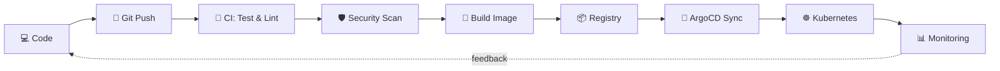

<!-- ============================================================
  GANTI semua "USERNAME" dengan username GitHub kamu.
  Repo ini harus bernama sama persis dengan username (profile repo).
============================================================= -->

<div align="center">


<a href="https://github.com/rizkyprofs">
  
</a>

<br/>


</div>

---

## 👨‍💻 Tentang Saya

```yaml
name: Rizky
role: DevOps Engineer
location: Bandung, Indonesia 🇮🇩
focus: [CI/CD, Kubernetes, IaC, Observability, DevSecOps]
currently_learning: [Platform Engineering, eBPF, GitOps]
available_for: [freelance, collaboration, open-source]
fun_fact: "Server saya lebih sering update daripada HP saya"
```

---

## 🔭 Yang Sedang Dikerjakan

- 🏗️ **Infrastructure as Code**: provisioning cloud dengan Terraform + Ansible
- ⚙️ **CI/CD Pipeline**: GitHub Actions / GitLab CI dengan security scanning (Trivy, SonarQube)
- ☸️ **Kubernetes & GitOps**: deploy otomatis pakai ArgoCD
- 📈 **Observability**: Prometheus, Grafana, Loki untuk monitoring
- 🏠 **Homelab**: Proxmox cluster sebagai tempat eksperimen

---

## 🔄 Workflow Saya



---

## 🛠️ Tech Stack

<div align="center">

**☁️ Cloud**


**🐳 Containers & Orchestration**


**🏗️ IaC & Config Management**


**🔁 CI/CD**


**📈 Monitoring & Observability**


**🐧 OS, Web & Scripting**


</div>

<details>
<summary><b>📚 Lihat detail skill</b></summary>

| Area | Tools | Level |
|------|-------|-------|
| Containerization | Docker, Podman, Docker Compose | ⭐⭐⭐⭐ |
| Orchestration | Kubernetes, Helm, K3s | ⭐⭐⭐ |
| IaC | Terraform, Ansible, Packer | ⭐⭐⭐⭐ |
| CI/CD | GitHub Actions, GitLab CI, Jenkins | ⭐⭐⭐⭐ |
| GitOps | ArgoCD, FluxCD | ⭐⭐⭐ |
| Monitoring | Prometheus, Grafana, Loki, Alertmanager | ⭐⭐⭐ |
| Security | Trivy, Vault, SonarQube, Fail2ban | ⭐⭐⭐ |
| Scripting | Bash, Python, Go | ⭐⭐⭐⭐ |

</details>

---

## 🏠 Homelab

```text
┌─────────────────────────────────────────────┐
│  Proxmox VE Cluster                         │
│  ├── k3s-master   (Ubuntu 22.04)  2C / 4GB  │
│  ├── k3s-worker-1 (Ubuntu 22.04)  2C / 4GB  │
│  ├── k3s-worker-2 (Ubuntu 22.04)  2C / 4GB  │
│  ├── monitoring   (Prometheus + Grafana)    │
│  ├── gitlab-runner                          │
│  └── pihole + wireguard                     │
└─────────────────────────────────────────────┘
```

> Ganti diagram di atas dengan setup homelab kamu yang sebenarnya.

---

## 📌 Featured Projects

| Project | Deskripsi | Stack |
|---------|-----------|-------|
| [**infra-as-code**](https://github.com/USERNAME/infra-as-code) | Provision VPC, EKS, dan RDS lewat Terraform module | `Terraform` `AWS` |
| [**ansible-playbooks**](https://github.com/USERNAME/ansible-playbooks) | Hardening & setup server otomatis | `Ansible` `Linux` |
| [**k8s-gitops**](https://github.com/USERNAME/k8s-gitops) | Manifest cluster dengan ArgoCD | `K8s` `ArgoCD` `Helm` |
| [**ci-templates**](https://github.com/USERNAME/ci-templates) | Reusable workflow CI/CD dengan security scan | `GitHub Actions` |

---

## 📊 GitHub Stats

<div align="center">


</div>

---

## 🐍 Contribution Snake

<div align="center">

<picture>
  <source media="(prefers-color-scheme: dark)" srcset="https://raw.githubusercontent.com/USERNAME/USERNAME/output/github-snake-dark.svg" />
  <source media="(prefers-color-scheme: light)" srcset="https://raw.githubusercontent.com/USERNAME/USERNAME/output/github-snake.svg" />
  
</picture>

</div>

---

## 🏅 Sertifikasi

<!-- Hapus yang belum kamu punya, tambahkan yang sudah -->
[](#)
[](#)
[](#)

---

## 🤝 Mari Terhubung

<div align="center">

[](https://linkedin.com/in/USERNAME)
[](mailto:email@kamu.com)
[](https://blog.kamu.dev)
[](https://instagram.com/USERNAME)

<br/>

*"It works on my machine" → "It works in production, with rollback."* 🚀


</div>
